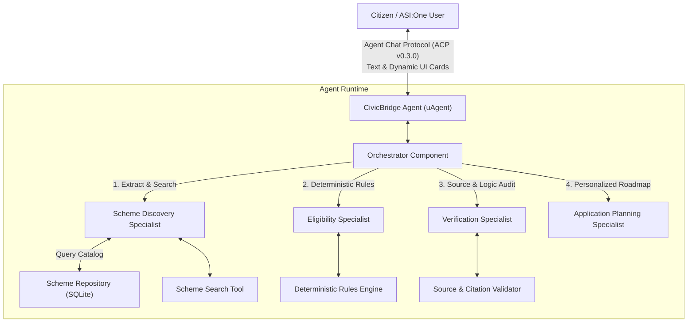
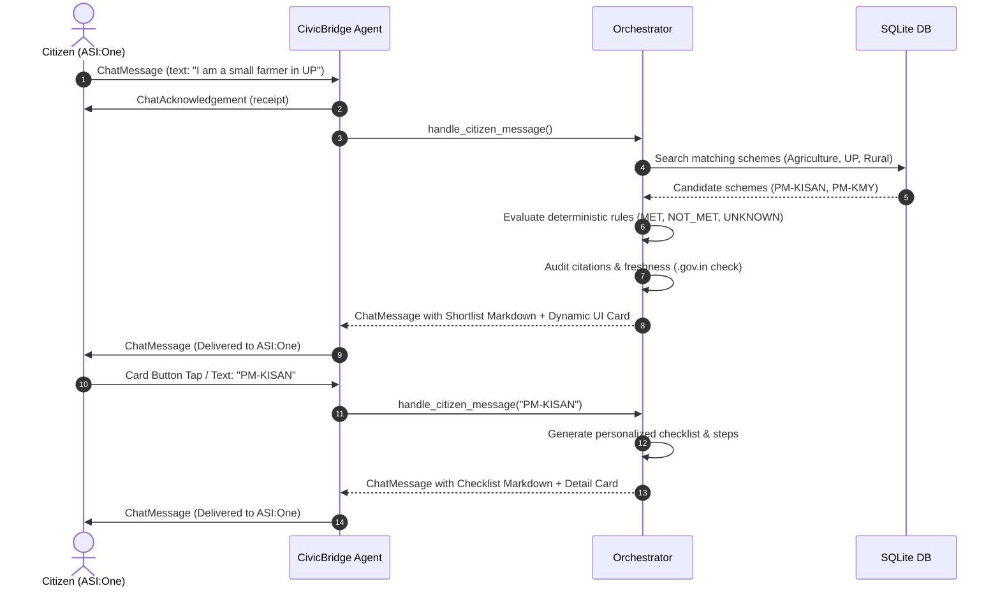

# CivicBridge Architecture & Design Specification

## 1. Overview

**CivicBridge** is an autonomous AI-agent system designed for Indian citizens to navigate complex government welfare programs, verify eligibility deterministically, and generate personalized application checklists.

Built on **Fetch.ai uAgents**, the **Agent Chat Protocol (ACP v0.3.0)**, and **ASI:One**, CivicBridge delivers an interactive, conversational advisory workflow directly within decentralized chat interfaces without requiring any custom third-party frontend.

---

## 2. Multi-Specialist Component Architecture

CivicBridge uses a modular, specialist-driven architecture coordinated inside a single high-performance agent runtime:



### Component Roles

1. **Orchestrator (`agent/orchestrator.py`)**
   - Ingests inbound ACP `ChatMessage` blocks and card button actions (`MetadataContent`).
   - Maintains conversational session state (`UserSession`) per citizen.
   - Parses applicant attributes (state, residence, age, occupation, income, caste, landholding) while enforcing privacy safeguards (explicitly forbidding Aadhaar numbers).
   - Coordinates specialist calls in sequence and handles partial data, missing criteria, or edge-case inputs gracefully.
   - Formats comprehensive markdown shortlists and generates ASI:One interactive element-tree cards.

2. **Scheme Discovery Specialist (`specialists/discovery.py`)**
   - Connects to the local SQLite repository via `SchemeSearchTool`.
   - Filters candidate schemes by primary category, urban/rural residence, state coverage, and livelihood.
   - Relaxes filters progressively if strict matching yields no candidates.

3. **Eligibility Specialist (`specialists/eligibility.py`)**
   - Evaluates explicit, structured criteria using deterministic Python comparison logic (`tools/eligibility_rules.py`).
   - Produces structured results for every rule with status:
     - `MET`: Condition verified by provided profile data.
     - `NOT_MET`: Condition violated by provided profile data.
     - `UNKNOWN`: Information missing from profile; never assumed to be eligible.
   - Computes overall category: `ELIGIBLE`, `LIKELY_ELIGIBLE`, `POTENTIALLY_ELIGIBLE`, or `NOT_ELIGIBLE`.

4. **Verification Specialist (`specialists/verification.py`)**
   - Checks that all candidate schemes reference authorized `.gov.in`, `.nic.in`, or approved welfare portal domains.
   - Validates secure HTTPS transport and flags unencrypted links.
   - Validates verification freshness against a 365-day threshold to flag stale records.
   - Audits eligibility outputs against structured rules to ensure integrity.

5. **Application Planning Specialist (`specialists/application_planner.py`)**
   - Generates tailored document checklists (customizing certificates based on citizen caste, landholding, or income).
   - Formulates step-by-step application instructions (online portals or CSC/Gram Panchayat centers).
   - Outlines crucial preconditions (Aadhaar-mobile linking, DBT NPCI bank mapping) and official helpline URLs.

---

## 3. Protocol & Messaging Flow



---

## 4. ASI:One Dynamic UI Integration

CivicBridge conforms to the official **Agentverse Element-Tree Specification**:
- **Protocol Header**: Transmitted as a `MetadataContent` block alongside markdown `TextContent`.
- **Card Payload Schema**:
  ```json
  {
    "card_protocol_version": "1",
    "requires_card_interaction": "true",
    "card_kind": "custom",
    "card_payload": "{\"root\": {\"type\": \"section\", \"title\": \"...\", \"children\": [...]}}"
  }
  ```
- **Dual Compatibility**: Because every message includes both markdown `TextContent` and element-tree `MetadataContent`, the agent functions seamlessly in standard terminal ACP clients, web chat, and rich ASI:One card carousels.

---

## 5. Security & Privacy Guardrails

1. **No Sensitive Identifiers**: CivicBridge never asks for, records, or stores Aadhaar numbers, PAN numbers, bank account numbers, or passwords.
2. **Deterministic Evaluation**: Calculations (age boundaries, income caps, landholding ceilings) use strict arithmetic in Python rather than relying on LLM guesses.
3. **Official Citation Whitelist**: Sources are checked against approved `.gov.in` and `.nic.in` domains.
4. **Advisory Disclaimer**: All output explicitly reminds citizens that assessments are informational and official sanction rests exclusively with government authorities.
